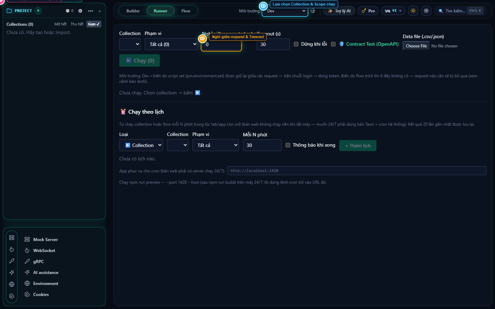

# ReqX — Ultra-Fast, 100% Offline, Git-Native API Client & Automation Suite

<p align="center">
  
</p>

<p align="center">
  <strong>The ultimate lightweight Postman alternative built for developer sovereignty.</strong><br>
  Zero mandatory login • Zero telemetry tracking • True Multi-level Collection Tree • Sub-second startup • Memory footprint under 100MB.
</p>

<p align="center">
  <a href="https://github.com/lgponlylove/reqX"></a>
  <a href="https://github.com/lgponlylove/reqX"></a>
  <a href="LICENSE"></a>
  
</p>

---

## ⚡ Why Developers Are Migrating from Postman to ReqX

For over a decade, Postman was the undisputed industry standard. But recent versions forced **mandatory cloud synchronization**, account logins, and locked critical local features behind paywalls (like limiting the Collection Runner to just 25 runs/month), all while ballooning to **1GB+ of RAM** on heavy Electron runtimes.

**ReqX** was built from the ground up with **Tauri v2 + Rust** to deliver what developers have been begging for: a fast, private, and unlimited API client.

---

## 🥊 Head-to-Head: Postman vs. ReqX

| Capability / Feature | Postman (Recent Versions) | **ReqX (Open Core)** |
| :--- | :---: | :---: |
| **Collection Organization** | ❌ Flat list only (impossible to group microservices) | ✅ **Multi-Level Directory Tree (Tree Structure)** |
| **Privacy & Storage** | ❌ Forced Cloud Sync, telemetry tracking | ✅ **100% Offline-First**, zero cloud leaks, zero accounts |
| **Team Collaboration** | ❌ Expensive cloud seat fees ($14–$49/user/mo) | ✅ **Git-Native Workspace (`reqx_workspace`)** commit to Git |
| **Collection Runner** | ❌ Paywalled to **25 runs/month** on Free plan | ✅ **100% Unlimited**, native CSV/JSON bulk iterations |
| **RAM Footprint** | ❌ 800 MB – 1.5 GB (Heavy Electron) | ✅ **~60 MB – 120 MB** (High-performance Rust/Wasm) |
| **Startup Speed** | ❌ 8 – 15 seconds | ✅ **Sub-second (~0.8s) instant launch** |
| **API Documentation** | ❌ Web-hosted, requires cloud sync | ✅ **1-Click Local HTML & Markdown export** |
| **Workflow Automation** | ❌ Cumbersome Newman CLI or paid flows | ✅ **Visual Smart Flow Canvas** with Timeline Waterfall |
| **AI Assistance** | ❌ Cloud-only Postbot, data sent to 3rd party | ✅ **Local Docs Inspector (0ms, 0 tokens)** + Local WebLLM |
| **Response Capture** | ❌ Manual snapshotting | ✅ **Auto Response Examples** (captures 200, 400, 500) |
| **Scripting Sandbox** | ✅ Standard `pm.*` API | ✅ **100% `pm.*` Compatible** (import collections seamlessly) |

---

## 💎 The 4 Core Pillars of ReqX

### 1. 🌲 Multi-Level Directory Tree & Git-Native Workspaces
Postman forces all your collections into one flat, unending sidebar list. In enterprise projects with 30+ microservices, this becomes unmanageable.
- **Hierarchical Directory Tree:** Group related collections under parent Project Directories (e.g. `[ERP System] -> Inventory API, Billing API, SSO Auth`).
- **Interactive Tree Structure Modal:** Visualize, reorder, and drag-and-drop collections and folders in a bird's-eye view.
- **Git Workspace Sync:** Export clean, human-readable directory structures into your repository. Commit API definitions alongside backend source code without merge conflicts.

### 2. ⚡ Frictionless Builder Experience
- **Smart Tab Focusing:** Open a `POST`, `PUT`, or `PATCH` request? ReqX **automatically focuses the Body tab** for you. Open a `GET` request? It lands straight on `Params`.
- **Intelligent Token Caching:** Say goodbye to pre-request scripts that re-fetch OAuth tokens every single click. ReqX caches tokens locally and only re-fetches when expired, saving 500ms on every request.
- **Parallel Environment Manager:** Open Environment variables directly in a tab alongside your requests in the Builder.

### 3. 🧪 Unlimited Automation & Mock Engine
- **Uncapped Collection Runner:** Run stress tests and batch regression runs without arbitrary monthly limits. Support for CSV & JSON data files with variable injection.
- **Smart Flow Canvas:** Drag and drop requests, extract response tokens, branch on HTTP status codes, and inspect exact step-by-step waterfall latency graphs.
- **Localhost Mock Server:** Boot a lightweight mock server in seconds with zero configuration to stub backend APIs with custom delays, headers, and status codes.

### 4. 📚 0ms Local Documentation & Autonomous AI
- **⚡ Local Docs Inspector (0ms, 0 tokens):** Query any request's cURL, sample bodies, error responses, or ReqX feature manuals with instant offline responses.
- **Auto Response Example Capture:** ReqX automatically records real-world `200 OK`, `400 Bad Request`, and `500 Server Error` responses whenever you hit Send, building living documentation as you work.
- **1-Click Documentation Export:** Generate polished, standalone HTML documentation (interactive search, dark mode, color-coded badges) or Git-ready Markdown files with a single click.
- **Hybrid AI Architecture:** Run 100% locally with in-app **WebLLM** (GPU-accelerated Qwen2.5/SmolLM2) or connect to your own Gemini, Groq, Mistral, or Ollama endpoints with automated self-verifying test generation.

---

## 📸 Screenshots

<p align="center">
  
  <br><em>Multi-tab Builder with smart Body focusing and live variable highlighting</em>
</p>

<p align="center">
  
  <br><em>Smart Flow Canvas: Visual API chaining and conditional branching</em>
</p>

<p align="center">
  
  <br><em>Unlimited Collection Runner with contract validation and data files</em>
</p>

<p align="center">
  
  <br><em>Local Docs Inspector & AI Chain with automated test dry-runs</em>
</p>

---

## 🚀 Quick Start & Installation

### Option 1: Download Pre-built Binaries
Grab the latest release for your platform from the releases page:
👉 **[Download ReqX (Windows & Linux)](https://github.com/lgponlylove/reqX)**

- **Windows:** `.msi` installer or portable `.zip` (zero install needed).
- **Linux:** `.AppImage` (runs on all distros) and `.deb` (Debian/Ubuntu).

### Option 2: Build from Source
```bash
# Clone the repository
git clone https://github.com/lgponlylove/reqX.git
cd reqX

# Install frontend dependencies
npm install

# Run in development mode (hot-reloading)
npm run tauri dev

# Build production bundle
npm run tauri build
```

---

## 🔄 3-Second Migration from Postman

Switching is completely painless:
1. Open Postman $\rightarrow$ Click **Settings** $\rightarrow$ **Data** $\rightarrow$ **Export data** (or export any Collection as `v2.1`).
2. Open ReqX $\rightarrow$ Click **Import** in the sidebar (or press `Ctrl + O`).
3. Select your `.postman_collection.json` or `.postman_environment.json` file.
4. **Done!** All your requests, folders, parameters, scripts, and auth configs are immediately ready to run locally.

---

## 📄 License

ReqX is distributed under the **PolyForm Noncommercial License 1.0.0**. Free for personal, educational, testing, and open-source development use. For commercial enterprise licensing, please visit our repository.
