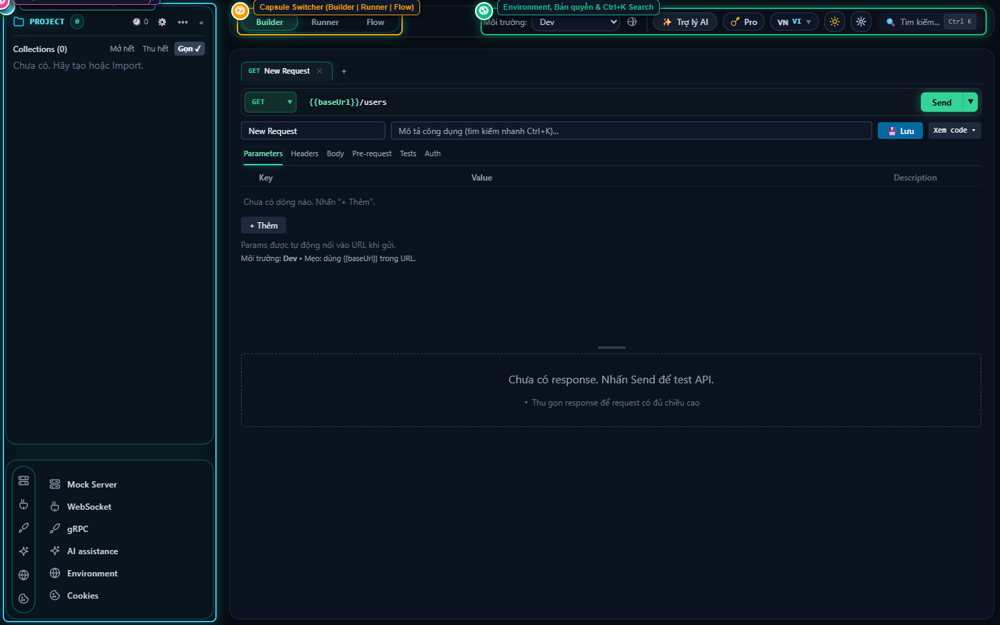
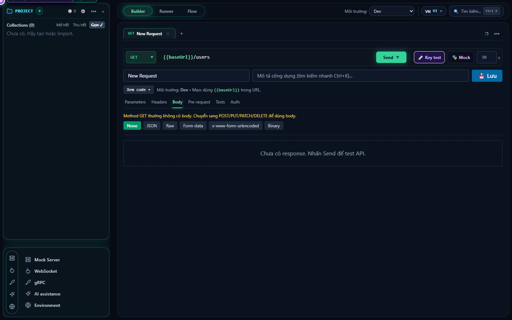
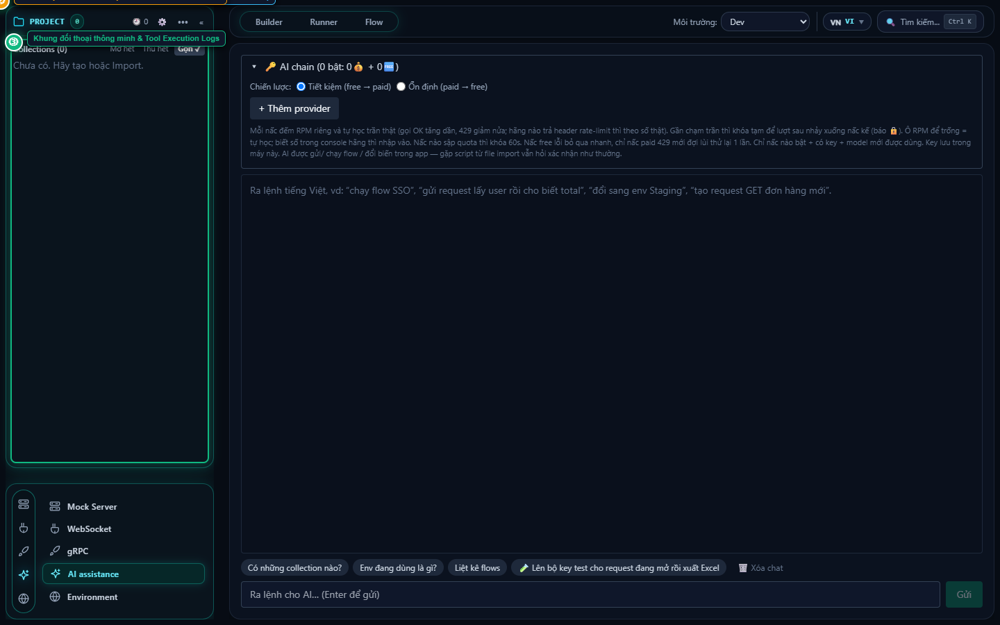
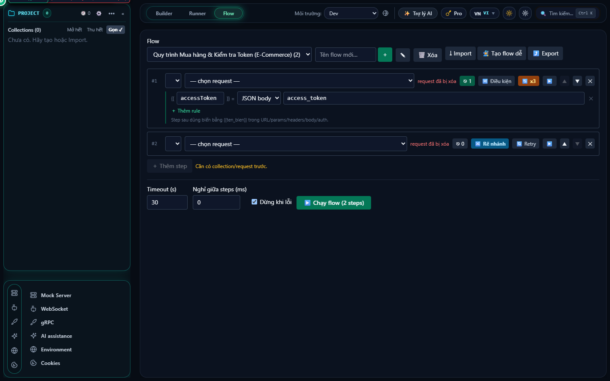
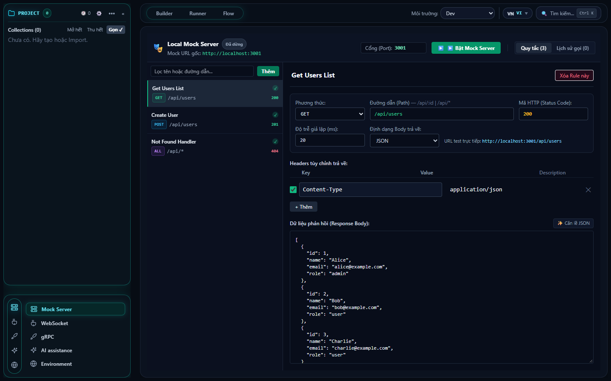

# ReqX — Ultra-Fast, Privacy-First Native API Client with Adaptive AI Chain

<p align="center">
  
</p>

<p align="center">
  <strong>The lightweight, 100% offline-first Postman alternative built with Rust & Tauri.</strong><br>
  No mandatory cloud login. Zero telemetry tracking. Instant ~1s startup. Memory footprint under 80MB.
</p>

<p align="center">
  <a href="https://github.com/lgponlylove/reqX-releases"></a>
  <a href="LICENSE"></a>
  
  
</p>

---

## ⚡ Why ReqX?

For years, developers loved Postman. But recent updates forced **mandatory cloud synchronization**, account logins, and locked critical local features behind paywalls, all while consuming upwards of **1GB+ RAM** on heavy Electron runtimes.

**ReqX** was built from the ground up to restore developer sovereignty:
- 🚀 **Blazingly Fast:** Powered by **Tauri v2 + Rust**, booting in under 1 second and sipping just **~40–80MB RAM**.
- 🔒 **100% Offline-First:** Your collections, variables, history, and secret tokens live strictly on your machine. Zero cloud dependency, zero data leaks.
- 🤖 **Adaptive AI Chain:** Connects to Gemini, Groq, Mistral, OpenRouter, Cloudflare, or **Local LLMs (Ollama)** with automatic failover, adaptive RPM rate-limiting, and **autonomous script verification (`Auto-verify`)**.
- 📦 **Seamless Postman Compatibility:** 100% compatible with Postman v2.1 collections, environments, and `pm.*` script sandboxes. Import your work and pick up without missing a beat.
- 🎯 **No Artificial Limits:** Unlimited tabs, unlimited collection runner iterations, uncapped mock server rules, and zero forced sign-ups.

---

## 📸 Key Features & Screenshots

### 1. High-Performance Request Builder & Multi-Tab Workspace
Send HTTP/1.1, HTTP/2, WebSocket, gRPC Protobuf, and Server-Sent Events (SSE) with multithreaded native Rust speed. Native execution bypasses browser CORS restrictions completely.



### 2. Autonomous AI Assistant with "AI Chain" & Auto-Verification
Ask AI in natural language to write test scripts, inspect schemas, generate requests, or diagnose response failures. 
- **AI Chain Architecture:** Seamlessly falls over between free and paid tiers.
- **Local LLM Support:** Use **Ollama** (`localhost:11434`) for 100% private, air-gapped AI assistance.
- **Auto-Verify Loop:** When AI generates a script, ReqX dry-runs a test execution in the background, catches runtime errors, and commands the AI to fix them before saving.



### 3. Smart Flow Runner & Request Chaining
Link multiple API steps into visual execution flows. Extract tokens from previous responses and pipe them directly into subsequent requests with intuitive visual progress tracking.



### 4. Automated Boundary & Edge-Case Test Generation
One-click extreme test case generator: inspects your JSON body schemas and automatically synthesizes boundary test suites (missing fields, null injections, type mismatches, SQL/XSS edge-cases) with status expectations.

### 5. Local Mock Server
Spin up an in-memory mock server in seconds to simulate backend endpoints with custom HTTP status codes, headers, and dynamic response delays.



### 6. 1-Click Interactive API Documentation Export
Export complete collection documentation directly into clean **Markdown** (for Git commits) or standalone **interactive HTML** (with searchable navigation, method badges, and printable styling) without needing third-party SaaS hosting.

---

## 📊 Comparison Matrix

| Feature | Postman | Yaak | **ReqX** |
| :--- | :---: | :---: | :---: |
| **Engine / Architecture** | Bloated Electron | Tauri v2 + Rust | **Tauri v2 + Rust** |
| **RAM Consumption** | 800MB – 1.5GB | ~60MB | **~40MB – 80MB** |
| **100% Offline / Local Storage** | ❌ (Mandatory Cloud) | ✅ | **✅ (100% Private)** |
| **Account Login Required** | ❌ Mandatory | ✅ Optional | **✅ Not Required** |
| **Postman `pm.*` Sandbox Scripts** | ✅ | ❌ Partial | **✅ Full Compatibility** |
| **Autonomous AI Assistant** | ❌ (Basic Cloud Bot) | ❌ None | **✅ Multi-Provider Chain + Auto-Verify** |
| **Local Offline LLMs (Ollama)** | ❌ | ❌ | **✅ Built-in** |
| **Extreme Test Case Generator** | ❌ | ❌ | **✅ Built-in** |
| **Local Mock Server** | Cloud Only | ❌ | **✅ Built-in** |
| **Runner Iteration Caps** | 25 runs/mo (Free) | Unlimited | **Unlimited** |

---

## 🚀 Installation & Download

Pre-built binaries and portable packages are available on the releases repository:

👉 **[Download Latest Version (reqX-releases)](https://github.com/lgponlylove/reqX-releases/releases)**

- **Windows:** `.exe` installer, `.msi` package, or zero-install `.zip` portable.
- **Linux:** `.AppImage` (portable for all distributions) and `.deb` (Debian/Ubuntu).

---

## 🛠️ Building from Source

### Prerequisites
- [Node.js](https://nodejs.org/) (v20+ recommended)
- [Rust & Cargo](https://rustup.rs/) (v1.75+)

### Steps

1. **Clone the repository:**
   ```bash
   git clone https://github.com/lgponlylove/reqX.git
   cd reqX
   ```

2. **Install frontend dependencies:**
   ```bash
   npm install
   ```

3. **Run in development mode:**
   ```bash
   npm run tauri:dev
   ```

4. **Run unit & integration test suites:**
   ```bash
   npm test
   ```
   *(All 38 test suites / 375 tests run offline in seconds via Vitest)*

5. **Build production binaries:**
   ```bash
   npm run tauri:build
   ```
   *(Compiled binaries will be generated in `src-tauri/target/release/bundle/`)*

---

## 🛡️ License & Commercial Rights

ReqX is licensed under the **[PolyForm Noncommercial License 1.0.0](LICENSE)**.

- **Free for Community:** You are welcome to view, study, audit, and use ReqX for all personal, educational, security audit, and noncommercial purposes.
- **Commercial & Enterprise Use:** Any commercial use or enterprise deployment requires a commercial license. For licensing inquiries, please contact: `maillamtien@gmail.com`.

---

<p align="center">
  Crafted with ❤️ by <strong>LGP</strong>. If ReqX speeds up your workflow, please give us a <strong>⭐ Star</strong> on GitHub!
</p>
