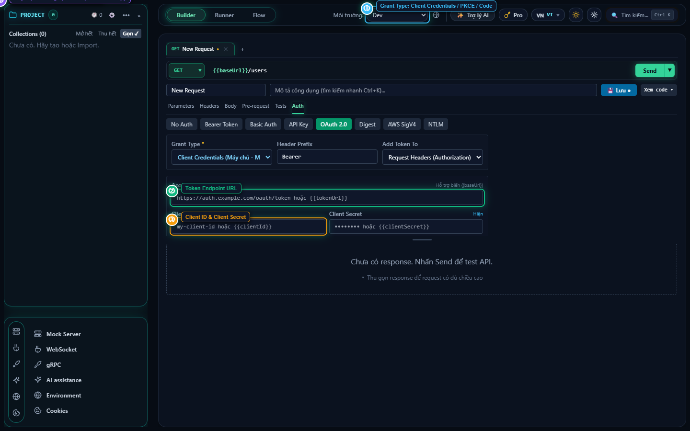
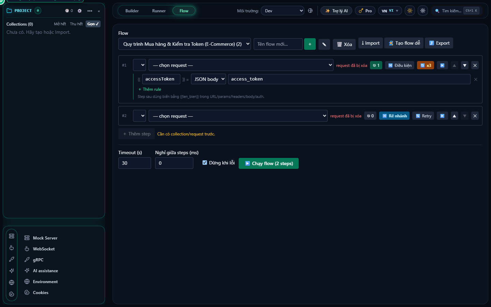
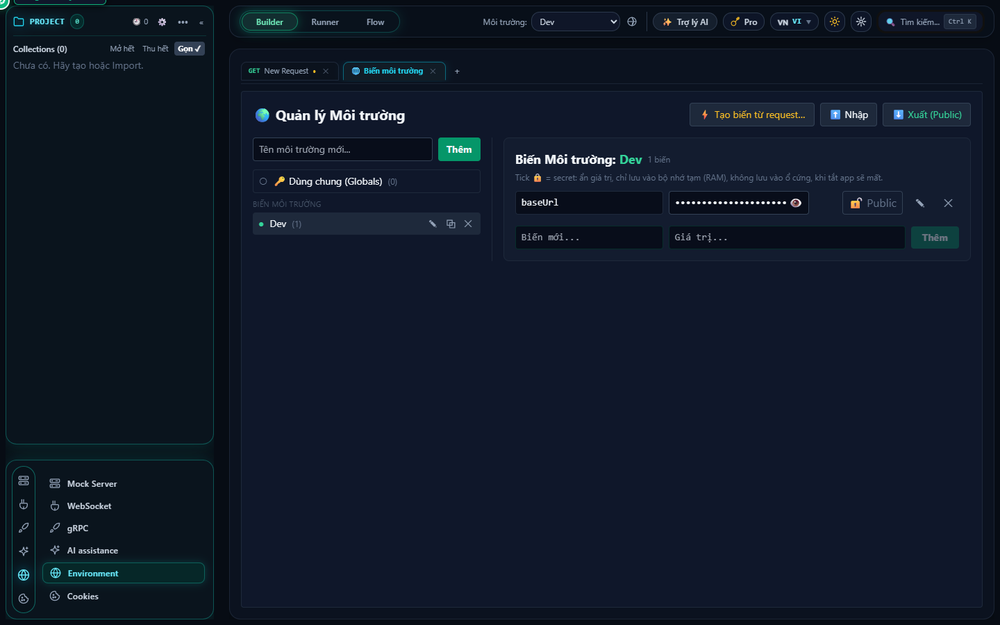
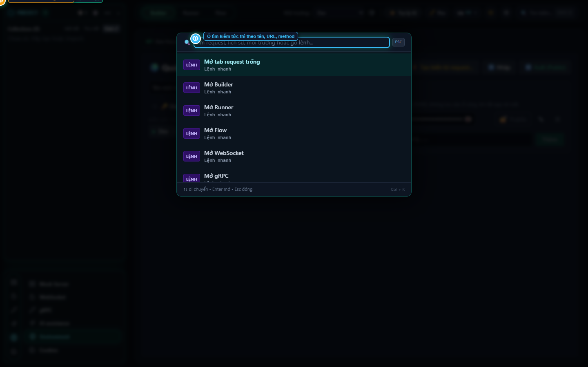

# ReqX API Client — Cẩm Nang Hướng Dẫn Sử Dụng Chi Tiết

> **Phiên bản:** ReqX Enterprise v2.4 (Ultra-fast Local API & Automation Suite)  
> **Tài liệu gốc Word (.DOCX):** [ReqX_Huong_Dan_Su_Dung_Chi_Tiet_v2.docx](./ReqX_Huong_Dan_Su_Dung_Chi_Tiet_v2.docx) *(Đã đóng gói đầy đủ 10 hình ảnh HD thực tế kèm khoanh vùng chỉ số, bảng chú giải chuẩn in ấn)*  
> **Ngày cập nhật:** Tháng 10/2026

---

## Mục Lục
1. [Tổng quan giao diện chính & Thanh điều hướng (Cyber Dock)](#1-tổng-quan-giao-diện-chính)
2. [Soạn & Thực thi API Request (Request Builder)](#2-soạn--thực-thi-api-request-request-builder)
3. [Xác thực nâng cao (OAuth 2.0 & Token Generator 10/10)](#3-xác-thực-nâng-cao-oauth-20--token-generator)
4. [Tự động hóa kịch bản (Smart Flow & Timeline Waterfall)](#4-tự-động-hóa-kịch-bản-smart-flow--timeline)
5. [Chạy hàng loạt & Kiểm thử hợp đồng (Runner & OpenAPI Contract Test)](#5-chạy-hàng-loạt--kiểm-thử-hợp-đồng-runner--contract-test)
6. [Máy chủ giả lập (Mock Server Engine)](#6-máy-chủ-giả-lập-mock-server-engine)
7. [Quản lý Môi trường & Khóa bảo mật (Environment & Secrets)](#7-quản-lý-môi-trường--khóa-bảo-mật-environment--secrets)
8. [Tìm kiếm nhanh (Command Palette Ctrl + K)](#8-tìm-kiếm-nhanh-command-palette-ctrl--k)
9. [Trợ lý AI Thông Minh (AI Assistant & Sinh Key Test Tự Động)](#9-trợ-lý-ai-thông-minh-ai-assistant--sinh-key-test-tự-động)
10. [Bảng So Sánh Đối Chiếu Chi Tiết: ReqX vs. Postman](#10-bảng-so-sánh-đối-chiếu-chi-tiết-reqx-vs-postman)
11. [Bảng Phím Tắt Nhanh (Cheat Sheet)](#11-bảng-phím-tắt-nhanh-cheat-sheet)

---

## 1. Tổng quan giao diện chính

ReqX được thiết kế với ngôn ngữ giao diện công thái học tối màu (Dark Cyber Glass), kết hợp hiệu ứng neon tinh tế và hiệu năng phản hồi tức thì (Zero-Lag) nhờ nhân Rust Native.

### Bảng chú thích thành phần:
- **① Tree Sidebar & Cyber Dock**: Phân cấp thư mục dự án (Collections, Folders, Requests). Bên dưới tích hợp Cyber Dock truy cập nhanh: Mock Server, WebSocket, gRPC, Cookies và Environment.
- **② Capsule Workspace Switcher**: Chuyển đổi 1-click giữa 3 không gian làm việc chuyên sâu:
  - `Builder`: Soạn thảo API request đơn lẻ và quản lý Environment Tab.
  - `Runner`: Chạy kiểm thử tự động hàng loạt collection kèm Data File CSV/JSON.
  - `Flow`: Thiết kế luồng tích hợp, workflow tự động đa bước kèm Timeline Waterfall.
- **③ Nút Bật / Tắt Trợ Lý AI (Postbot Drawer)**: Ngăn kéo thông minh trượt từ cạnh phải, hỗ trợ kéo rê co giãn độ rộng linh hoạt để vừa chat vừa theo dõi kết quả request.
- **④ Request Bar & Action Controls**: Thanh nhập phương thức HTTP (GET, POST, PUT, DELETE, PATCH...), nhập URL hỗ trợ biến `{{baseUrl}}`. Tự động nhận diện lệnh cURL khi dán. Nút **Send** có phím tắt `Ctrl + Enter`.
- **⑤ Thanh Header, Bản Quyền & Ctrl+K Search**: Chọn nhanh môi trường, mở bảng quản lý bản quyền (License), đổi theme Sáng/Tối, đa ngôn ngữ và phím tắt mở Command Palette.

---

## 2. Soạn & Thực thi API Request (Request Builder)

Khu vực làm việc trung tâm cung cấp đầy đủ khả năng cấu hình tham số, tiêu đề, nội dung và các bộ test tự động.

### Các tính năng chính:
- **① Thanh nhập URL & Tự động nhận diện cURL**: Hỗ trợ Auto-complete biến môi trường khi gõ `{{`. Dán trực tiếp lệnh cURL từ DevTools/Swagger để tự động điền form.
- **② Bộ chọn chế độ Body đa dạng**: Hỗ trợ đầy đủ: `none`, `form-data` (hỗ trợ đính kèm file thật), `x-www-form-urlencoded`, `raw`, `binary` và `GraphQL` (với Query + Variables editor riêng).
- **③ Raw Subtypes & Auto Content-Type**: Khi chọn raw, dễ dàng chuyển đổi nhanh giữa `JSON`, `Text`, `XML`, `HTML`, `JavaScript`. Hệ thống tự động gán đúng Header `Content-Type`.
- **④ ⚡ Key Test Cực Đoan Tự Động**: Quét JSON schema sinh ngay 30 - 50 ca kiểm thử biên (null, chuỗi rỗng, số âm, overflow, SQL injection) và mở bảng duyệt Key Test Suite để chạy & xuất Excel.
- **⑤ JSON Highlighting & Bảng Response**: Trình soạn thảo định dạng làm đẹp với nút Beautify JSON, hiển thị Status Code, độ trễ (Latency ms) và dung lượng phản hồi.

---

## 3. Xác thực nâng cao (OAuth 2.0 & Token Generator)

ReqX hỗ trợ đầy đủ quy trình xác thực OAuth 2.0 hiện đại tương đương hoặc vượt trội so với Postman:

### Hướng dẫn sử dụng:
1. Tại tab **Auth**, chọn loại xác thực là **OAuth 2.0**.
2. **① Cấu hình Grant Type**: Hỗ trợ:
   - `Authorization Code (with PKCE)`: Dùng cho Single Page App / Mobile / Desktop an toàn.
   - `Client Credentials`: Dùng cho tích hợp Server-to-Server M2M.
   - `Password Credentials`: Dùng cho hệ thống nội bộ legacy.
   - `Implicit Grant`: Hỗ trợ kiểm thử token nhanh.
3. **② Nhập thông tin Endpoints**:
   - `Token URL`: Địa chỉ cấp phát Access Token (ví dụ: `https://auth.example.com/oauth/token`).
   - `Client ID` & `Client Secret`: Nhận diện ứng dụng (Client Secret tự động ẩn dưới dạng mật khẩu).
   - `Scope`: Phân quyền (ví dụ: `read:orders write:orders offline_access`).
4. **③ Nút "⚡ Get New Access Token"**: Bấm để ReqX thực hiện handshake ngầm, trao đổi mã và nhận Token ngay lập tức mà không cần copy thủ công từ bên ngoài.
5. **④ Thẻ Active Token & Đếm ngược hết hạn (Expires In)**: Hiển thị thời gian sống còn lại của token và tự động gắn header `Authorization: Bearer <token>` vào tất cả các request phát đi.

---

## 4. Tự động hóa kịch bản (Smart Flow & Timeline)

Smart Flow cho phép xâu chuỗi nhiều API liên hoàn với khả năng rẽ nhánh thông minh và tự phục hồi khi có sự cố.

### Cơ chế hoạt động:
- **Xâu chuỗi tuần tự (Step-by-step Execution)**: Request sau kế thừa biến môi trường do request trước trích xuất (ví dụ: Login -> Lấy `token` -> Tạo Order -> Thanh toán Order).
- **Điều kiện rẽ nhánh (Smart Branching)**:
  - Thiết lập điều kiện dựa trên Response Status Code hoặc trường JSON trả về (ví dụ: `res.status === 200`).
  - Khi điều kiện không thỏa mãn: Có thể lựa chọn `Skip Step` (bỏ qua), `Jump to Step` (nhảy cóc tới bước chỉ định) hoặc `Abort Flow` (dừng khẩn cấp).
- **Tự động thử lại khi lỗi (Auto Retry Policy)**: Cấu hình số lần retry tối đa (ví dụ: 3 lần) và thời gian trễ (Backoff Delay) giúp kiểm thử ổn định ngay cả khi mạng chập chờn.
- **Biểu đồ Timeline chi tiết**: Trực quan hóa chính xác từng micro-second thực thi của từng API, giúp phát hiện ngay nút thắt cổ chai (bottleneck) về hiệu năng.

---

## 5. Chạy hàng loạt & Kiểm thử hợp đồng (Runner & Contract Test)

### Điểm nổi bật:
- **Chạy hàng loạt từ Data File**: Hỗ trợ nhập file `CSV` hoặc `JSON` chứa hàng trăm bản ghi dữ liệu mẫu để lặp lại kiểm thử với các bộ tham số khác nhau.
- **Tự động kiểm định hợp đồng (OpenAPI Contract Testing)**:
  - Khi bật tùy chọn này, mỗi response trả về sẽ được đối chiếu tự động với JSON Schema chuẩn OpenAPI 3.0 / 3.1.
  - Báo động ngay lập tức nếu API trả về thiếu trường bắt buộc (`required`), sai kiểu dữ liệu (`type mismatch`), hoặc sai định dạng (`format invalid`).
- **Xuất báo cáo HTML/JSON tự động**: Tên file report được chuẩn hóa và tự động lưu trữ phục vụ CI/CD pipelines.

---

## 6. Máy chủ giả lập (Mock Server Engine)

ReqX tích hợp sẵn một Web Server nội bộ tốc độ cao, hỗ trợ làm việc song song (Frontend phát triển trước khi Backend hoàn thành):
- Khởi động Mock Server chỉ với 1 click chuột (chạy ngay trên localhost).
- Định nghĩa Mock Rules linh hoạt: khớp theo đường dẫn URL, phương thức HTTP, headers.
- Giả lập độ trễ mạng (Latency Simulation từ 0ms - 5000ms) để kiểm thử trạng thái loading của UI.
- Cửa sổ **Live Request Logs** hiển thị theo thời gian thực tất cả các client đang gọi vào mock server.

---

## 7. Quản lý Môi trường & Khóa bảo mật (Environment & Secrets)

Bộ quản lý môi trường được tích hợp thành một Tab chuyên dụng ngay trong Builder, giúp bạn chuyển đổi và cấu hình biến nhanh chóng mà không làm gián đoạn việc soạn thảo API:
- **Đa môi trường**: Chuyển đổi linh hoạt giữa `Dev Localhost`, `Staging`, `Production`.
- **Trường Secret (Bảo mật tuyệt đối)**: Các khóa API, JWT secret, mật khẩu được che mờ bằng dấu `••••••••` và chỉ hiển thị khi người dùng chủ động nhấn biểu tượng mắt.
- **Phạm vi biến toàn cục (Globals) & Cục bộ**: Phân tách rõ ràng giữa biến áp dụng cho toàn hệ thống và biến riêng cho từng môi trường.

---

## 8. Tìm kiếm nhanh (Command Palette Ctrl + K)

- Kích hoạt bằng tổ hợp phím **`Ctrl + K`** (hoặc `Cmd + K` trên macOS).
- Tìm kiếm tức thời bất kỳ Request, Collection, Flow, hay Cài đặt nào.
- Được kết xuất qua React Portal cấp cao nhất (`z-index: 9999`), đảm bảo hiển thị nổi bật và không bao giờ bị che khuất bởi các thanh điều hướng hay tiêu đề.

---

## 9. Trợ lý AI Thông Minh (AI Assistant & Sinh Key Test Tự Động)

ReqX tích hợp hệ thống Trợ lý AI thế hệ mới được thiết kế dạng ngăn kéo (Postbot Drawer) trượt từ cạnh phải màn hình, hỗ trợ SSE Streaming mượt mà, đa nhà cung cấp và có thể chạy hoàn toàn Offline với Ollama Local.

### Bảng chú thích thành phần:
- **① Ngăn kéo AI Postbot trượt từ cạnh phải**: Giao diện Drawer thông minh, hỗ trợ kéo rê viền trái để co giãn độ rộng linh hoạt hoặc thu nhỏ lại khi không dùng. Vừa chat vừa theo dõi kết quả request.
- **② Multi-Provider Chain & Hỗ trợ Ollama Local**:
  - Hỗ trợ đồng thời 6 nhà cung cấp AI: **Google Gemini**, **Groq**, **Mistral**, **OpenRouter**, **Cloudflare Workers AI** và **Ollama** (chạy model cục bộ 100% offline trên máy).
  - Cho phép cấu hình nhiều API Key, sắp xếp thứ tự ưu tiên bằng nút `↑` `↓` và chọn model theo nhu cầu.
  - Nút **`↻`** ở từng provider cho phép tự động đồng bộ danh sách models mới nhất trực tiếp từ API hãng.
- **③ Chiến Lược Failover & Adaptive RPM Breaker (Né Lỗi 429)**:
  - Hai chế độ chạy: `Tiết kiệm` (ưu tiên nấc miễn phí) hoặc `Ổn định` (ưu tiên nấc trả phí).
  - Thuật toán **AIMD** tự học trần Rate Limit (RPM) thực tế dựa trên header phản hồi, tự động khóa tạm thời nấc sắp chạm trần (báo `🔒`) để tránh bị lỗi HTTP 429 và tự động hồi phục sau 60 giây.
- **④ Khung Chat SSE Streaming & Gọi Lệnh Trực Tiếp (Tools Execution)**:
  - Phản hồi dạng SSE gõ chữ thời gian thực kèm nút Copy nhanh.
  - Trợ lý AI được cấp quyền gọi trực tiếp các Tools nội bộ trong app:
    - Liệt kê, tìm kiếm, mở và gửi request.
    - Tự động viết và chèn script Pre-request/Tests trực tiếp vào DB mà không cần người dùng copy-paste thủ công.
    - Xâu chuỗi tạo Smart Flow mới từ các request có sẵn.
    - Chuyển đổi Environment và gán biến môi trường.
    - Đồng bộ Git Workspace (`export_git_workspace` / `import_git_workspace`).
  - **Lập Bộ Test Cực Đoan Tự Động (Extreme Key Test Generator)**: Chỉ cần ra lệnh: *"Lên key test tự động cho API này"*, AI sẽ quét schema sinh **30 - 50 test cases biên** (null, rỗng, số âm, overflow, token sai, SQL injection...) và mở bảng duyệt để chạy & xuất file **Excel (CSV có BOM UTF-8)** tiếng Việt chuẩn xác.

---

## 10. Bảng So Sánh Đối Chiếu Chi Tiết: ReqX vs. Postman

| Tính Năng / Tiêu Chí | ⚡ ReqX (Local & AI-First) | Postman (Cloud Platform) |
| :--- | :--- | :--- |
| **1. Kiến Trúc & Tiêu Thụ RAM** | **Siêu nhẹ (< 50MB RAM)**, nhân Rust Native (Tauri), khởi động dưới 1 giây, phản hồi Zero-Lag. | **Nặng nề** (Chromium Electron tốn 600MB - 1.5GB RAM), khởi động lâu (5 - 15 giây). |
| **2. Quyền Riêng Tư & Đăng Nhập** | **Local-First 100%, Offline hoàn toàn**, không bắt buộc đăng nhập, dữ liệu nằm trọn trên máy tính của bạn. | **Bắt buộc đăng nhập tài khoản Cloud**, dữ liệu và lịch sử gọi API bị đồng bộ lên máy chủ hãng. |
| **3. Giới Hạn Collection Runner** | **KHÔNG GIỚI HẠN**, chạy bao nhiêu lần tùy ý, hỗ trợ Data File CSV/JSON lớn hoàn toàn miễn phí. | **Bị giới hạn nghiêm ngặt 25 lượt chạy/tháng** đối với tài khoản Free. |
| **4. Trợ Lý AI & Tự Động Hóa** | **Hỗ trợ 5 AI Providers** (Gemini, Groq, Mistral, OpenRouter, Cloudflare), AI Chain xoay vòng, gọi Tools thao tác trực tiếp trên app. | Postbot tính phí riêng hàng tháng ($9+/tháng), bị khóa chặt trong Cloud Postman, không can thiệp sâu vào app. |
| **5. Sinh Key Test Cực Đoan & Excel** | **Tự động quét JSON Schema sinh 30-50 case biên** (null, rỗng, số âm, SQL injection) và xuất Excel tiếng Việt có BOM 1-click. | **Không có**. Tester phải tự tay viết script assertion hoặc chuẩn bị file test data thủ công. |
| **6. Quy Trình Tự Động Hóa (Flows)** | **Smart Flow trực quan**, rẽ nhánh điều kiện (Skip/Jump), tự động thử lại khi lỗi (Retry policy), Timeline micro-second waterfall. | Phải viết code `postman.setNextRequest()` phức tạp trong script, dễ bị vòng lặp vô tận, không có timeline trực quan. |
| **7. OpenAPI Contract Testing** | **Tự động kiểm định JSON Schema chuẩn OpenAPI 3.0/3.1** tích hợp trong Runner, phát hiện lệch type/field ngay. | Phải nhúng thư viện Ajv thủ công trong test script từng request hoặc nâng cấp gói Enterprise đắt đỏ. |
| **8. Máy Chủ Mock Server** | **Mock Server nội bộ chạy ngay trên localhost**, giả lập delay, log real-time không phụ thuộc Internet. | Mock server đặt trên Postman Cloud, phụ thuộc mạng ngoài, có hạn ngạch request/tháng. |
| **9. Xác Thực OAuth 2.0** | **Hỗ trợ PKCE, Client Credentials**, nút `⚡ Get Token` tự động, thẻ đếm ngược hạn Token hiển thị trực quan. | Hỗ trợ OAuth 2.0 nhưng callback browser cloud dễ bị lỗi khi làm việc trong mạng nội bộ công ty (Intranet). |
| **10. Bảo Mật Secret & Biến Môi Trường** | **Chế độ ẩn mật khẩu/token dạng `••••••`**, tự động loại bỏ Secret khi xuất file chia sẻ cho đồng nghiệp. | Dễ xảy ra nguy cơ lộ Secret nếu vô ý share nhầm Workspace Public hoặc Team Workspace. |
| **11. Phối Hợp Nhóm Qua Git** | **Xuất/Nhập trực tiếp thư mục `reqx_workspace`**, quản lý phiên bản qua Git PR/Commit chuẩn bảo mật 100%. | Phải mua license Team/Enterprise ($15 - $49/user/tháng) để chia sẻ workspace trên Cloud. |
| **12. Giao Thức Đa Dạng** | **Hỗ trợ toàn diện**: HTTP/REST, WebSocket Tester và gRPC Tester (Protobuf / Web) tích hợp sẵn. | Có hỗ trợ WebSocket và gRPC nhưng giao diện cồng kềnh, tải nặng máy. |

---

## 11. Bảng Phím Tắt Nhanh (Cheat Sheet)

| Phím tắt | Chức năng thực hiện |
| :--- | :--- |
| **`Ctrl + Enter`** | Gửi Request hiện tại ngay lập tức (**Send Request**) |
| **`Ctrl + S`** | Lưu thay đổi của Request vào Collection (**Save**) |
| **`Ctrl + N`** | Tạo Request mới trong tab mới |
| **`Ctrl + K`** | Mở bảng lệnh tìm kiếm nhanh (**Command Palette**) |
| **`Ctrl + B`** | Định dạng làm đẹp JSON Body (**Beautify JSON**) |
| **`Ctrl + \`** | Ẩn / Hiện thanh Sidebar Collections |
| **`Ctrl + P`** | Mở nhanh Collection Runner |
| **`Esc`** | Đóng hộp thoại Modal / Command Palette đang mở |

---

*Tài liệu được biên soạn và phát hành chính thức cho người dùng và đội ngũ kiểm thử của ReqX.*
